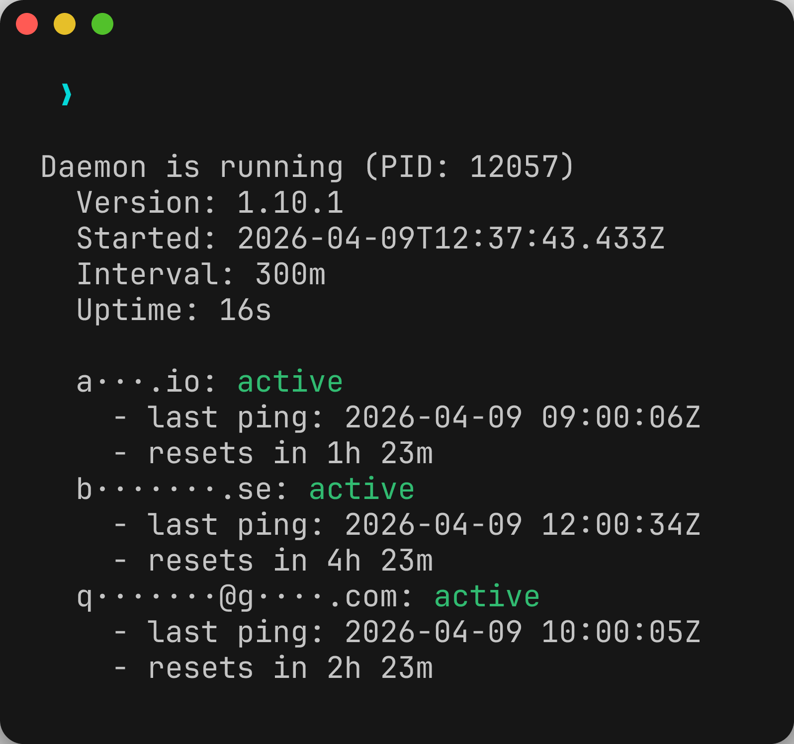

<p align="center">
  <picture>
    <source media="(prefers-color-scheme: dark)" srcset="./logo-dark.svg">
    
  </picture>
</p>

<h1 align="center">@wbern/cc-ping</h1>

<p align="center">Ping Claude Code sessions to trigger quota windows early across multiple accounts.</p>

<p align="center">
  <a href="https://www.npmjs.com/package/@wbern/cc-ping"></a>
  <a href="https://www.npmjs.com/package/@wbern/cc-ping"></a>
  <a href="https://github.com/wbern/cc-ping/actions/workflows/ci.yml"></a>
  <a href="https://opensource.org/licenses/MIT"></a>
  <br>
  <a href="https://claude.ai/code"></a>
  <a href="https://github.com/wbern/cc-ping/graphs/contributors"></a>
  <a href="https://github.com/wbern/cc-ping/pulls"></a>
</p>

<p align="center">
  
</p>

**Ping Claude Code sessions to trigger quota windows early across multiple accounts.**

Claude Code has a 5-hour quota window that starts on your first message. If you rotate between accounts, your idle accounts sit there with full quota doing nothing. cc-ping pings them so their windows start ticking — when you need them, they've already reset.

Zero telemetry. No data is collected, sent, or phoned home. Everything stays in `~/.config/cc-ping/`. The only network activity is the `claude` CLI call itself, which is subject to Anthropic's normal Claude Code telemetry.

## Safety and subscription caveats

cc-ping is an unofficial local personal-use helper and educational experiment for exploring Claude Code session timing, quota windows, and CLI automation. It is not made, endorsed, reviewed, or supported by Anthropic.

I cannot guarantee that this kind of usage will continue to be accepted under Claude subscription plans. Anthropic controls how Claude Code, `claude -p`, Agent SDK, and third-party automation usage count against plans, and these rules can change.

Anthropic's current support article says the previously announced Agent SDK / `claude -p` subscription change is paused: "For now, nothing has changed." It also says Claude Agent SDK, `claude -p`, and third-party app usage still draw from subscription usage limits, and Anthropic will "share it before anything takes effect." See [Use the Claude Agent SDK with your Claude plan](https://support.claude.com/en/articles/15036540-use-the-claude-agent-sdk-with-your-claude-plan). Treat this as a moving policy area, not a permanent guarantee.

Important limits:

- cc-ping may consume Claude subscription usage or quota.
- cc-ping depends on the local `claude` CLI behavior, output, authentication state, and plan limits.
- `experimental-interactive` simulates terminal interaction and is less stable than the default `print` mode.
- Real Claude tests are opt-in because they may consume quota.
- This is intended for local personal automation, not shared production automation at scale.

## Prerequisites

[Claude Code](https://docs.anthropic.com/en/docs/claude-code) must be installed and on your PATH. `expect` is only required for `experimental-interactive` pings.

```bash
claude --version   # verify it's available
expect -v          # optional: verify experimental PTY automation is available
```

## Install

### Standalone binary (recommended)

No Node.js required — downloads a single binary:

```bash
TAG=$(curl -fsSL https://api.github.com/repos/wbern/cc-ping/releases/latest \
  | grep '"tag_name"' | head -1 | cut -d'"' -f4)
curl -fsSL "https://raw.githubusercontent.com/wbern/cc-ping/${TAG}/install.sh" | bash -s -- "$TAG"
```

Installs to `~/.local/bin` by default. Override with `CC_PING_INSTALL_DIR`. You may need to restart your shell or add `~/.local/bin` to your PATH.

The two-step form pins the installer script to a published release tag rather than fetching it from `main`, so a single push to `main` cannot deliver attacker code to fresh installs. Both the script and the binary it downloads come from the same signed release. Inspect before piping with `curl -fsSL "https://raw.githubusercontent.com/wbern/cc-ping/${TAG}/install.sh" | less`.

To pin a specific version instead of the latest release:

```bash
TAG=v1.21.0
curl -fsSL "https://raw.githubusercontent.com/wbern/cc-ping/${TAG}/install.sh" | bash -s -- "$TAG"
```

### Homebrew (macOS / Linux)

```bash
brew install wbern/cc-ping/cc-ping
```

On macOS this builds from source (pulls in `bun` as a build dependency, ~1
minute on first install) to sidestep Sequoia's Gatekeeper rejecting
downloaded ad-hoc-signed binaries. Linux uses the prebuilt binary.

### npm / pnpm

Requires Node.js:

```bash
pnpm add -g @wbern/cc-ping
npm install -g @wbern/cc-ping   # also works
```

### Quick run (no install)

```bash
pnpm dlx @wbern/cc-ping ping   # requires pnpm
npx @wbern/cc-ping ping        # or npm
```

## Setup

Discover accounts from `~` (or a custom directory), then verify they have valid credentials:

```bash
cc-ping scan              # auto-discover accounts from ~
cc-ping scan /path/to/dir # scan a specific directory
cc-ping scan --yes        # non-interactive: keep configured + all discovered
cc-ping check             # verify credentials are valid
cc-ping login <handle>    # re-authenticate an account that lost its session
cc-ping list              # show configured accounts
```

Or add accounts manually:

```bash
cc-ping add ~/.claude-accounts/my-account
```

## Usage

```bash
cc-ping ping                          # ping all accounts
cc-ping ping alice bob                # ping specific accounts
cc-ping ping --parallel               # ping all at once
cc-ping ping --notify                 # desktop notification on new windows
cc-ping ping --bell                   # terminal bell on failure
cc-ping ping --stagger 5              # wait 5 min between each account
cc-ping status                        # show account status table
cc-ping suggest                       # which account should I use next?
cc-ping next-reset                    # when does the next window expire?
cc-ping config show                   # show effective settings
cc-ping config set pingMode experimental-interactive
cc-ping daemon start                  # auto-ping every 5 hours
cc-ping history                       # recent ping results
```

## Commands

### `cc-ping ping [handles...]`

Ping configured accounts to start their quota windows. Pings accounts sequentially by default.

| Flag | Default | Description |
|------|---------|-------------|
| `--parallel` | `false` | Ping all accounts simultaneously |
| `--stagger <minutes\|auto>` | — | Delay between each account (minutes, or `auto`) |
| `--notify` | `false` | Desktop notification on new windows and failures |
| `--bell` | `false` | Terminal bell on failure |
| `--json` | `false` | Output results as JSON |
| `--quiet` | `false` | Suppress per-account output |
| `--group <name>` | — | Only ping accounts in this group |

### `cc-ping status`

Show all accounts with their quota window state — whether they have an active window, when it resets, reset source/confidence, whether they're covered by recent Claude Code usage, and duplicate detection. A reset shown as `estimated/low` comes from `lastPing + 5h`, not from Claude.

### `cc-ping suggest`

Recommend which account to use next based on quota window state. Prefers accounts that need pinging or whose windows are about to reset.

### `cc-ping next-reset`

Show which account has its quota window resetting soonest — useful for knowing when capacity frees up. Output includes whether the reset is estimated, parsed from a rate-limit message, or manually overridden.

### `cc-ping scan`

Auto-discover Claude Code accounts. Scans `~` by default, or pass a directory to scan. Each subdirectory containing a `.claude.json` is detected as an account. Duplicate identities (same `accountUuid` across directories) are flagged. The default `~` scan skips system and cloud-sync folders (Documents, Pictures, Google Drive, Dropbox, …) to avoid triggering macOS permission prompts; an explicitly provided directory is searched verbatim.

By default, `scan` opens an interactive checklist. Existing configured accounts are selected by default, newly discovered accounts are marked `new` and unselected by default, and configured accounts missing from the scan remain selected unless you remove them. In non-interactive environments, `scan` will not save unless you pass `--yes`, which keeps all configured and discovered accounts.

```bash
cc-ping scan
cc-ping scan --dry-run
cc-ping scan --yes
```

### `cc-ping check`

Verify that each configured account's config directory exists and has credentials.

### `cc-ping login [handle]`

Re-authenticate accounts through the official `claude auth login` OAuth flow — useful after a ping reports `auth expired`. The browser/device flow runs interactively with no timeout, scoped to each account's `CLAUDE_CONFIG_DIR`, and prefills the account's email. Credentials are isolated per config directory, so logging into one account never disturbs another's session.

When a ping reports an expired or missing session — either an HTTP 401 or a "Not logged in" result — cc-ping records that account as needing login. Running `cc-ping login` with no handle logs in **all** flagged accounts in turn — it prints how many need login, then runs each interactive flow sequentially (the next begins only after the previous one exits). A successful login (or a later successful ping) clears the flag. Pass a handle to re-auth one specific account regardless of its flag. `cc-ping status` also surfaces a "needs login" hint for flagged accounts.

### `cc-ping add <config-dir>`

Manually add an account by config directory path. The handle defaults to the directory name — override with `--name`.

### `cc-ping remove <handle>`

Remove an account from the configuration. Also clears the account's last-ping state (timestamp and metadata). Ping history in `history.jsonl` is preserved as an audit log.

### `cc-ping cleanup`

Remove orphan state entries for handles that are no longer in the configuration — useful after account renames or manual config edits. Use `--dry-run` to preview without writing. Supports `--json` for scripted use. Does not touch `history.jsonl`.

### `cc-ping list`

List all configured accounts with their config directory paths.

### `cc-ping config`

Show or update settings without hand-editing JSON:

```bash
cc-ping config show
cc-ping config show --json
cc-ping config set pingMode print
cc-ping config set pingMode experimental-interactive
cc-ping config set model haiku
cc-ping config set interactiveExitDelayMs 2500
cc-ping config set interactiveReadyPattern "(\\u276f|>|›)[ \\u00a0]*"
cc-ping config set interactiveReadyFallbackDelayMs 5000
cc-ping config set promptStyle mixed
cc-ping config set promptStyle chess
```

### `cc-ping reset`

Set or clear account-level reset overrides when Claude shows a reset time that cc-ping cannot observe or parse:

```bash
cc-ping reset set alice "2026-06-18T15:00:00"
cc-ping reset clear alice
```

Manual overrides appear as `manual_override/high` in `status` and `next-reset`.

### `cc-ping history`

Show recent ping results — handle, success/failure, duration, failure reason, and parsed reset timestamp when available.

### `cc-ping schedule reset [handle]`

Reset smart scheduling data to recompute optimal ping times. Pass a handle to reset a specific account, or omit it to reset all accounts.

### `cc-ping completions <shell>`

Generate shell completion scripts for `bash`, `zsh`, or `fish`.

### `cc-ping moo`

Send a test notification to verify notifications work on your platform. Fires a desktop notification, and — if a remote URL is configured — a remote (phone) push too.

### `cc-ping notify set [topic]`

Set up remote phone notifications via [ntfy.sh](https://ntfy.sh) (or a compatible server). Omit the topic to have a secure, hard-to-guess one generated for you; the command then prints the next steps (install the app, subscribe, test). The topic is the credential, so treat it as a secret. See [Remote notifications](#remote-notifications).

| Flag | Default | Description |
|------|---------|-------------|
| `--server <url>` | `https://ntfy.sh` | ntfy-compatible server base URL (for self-hosting) |

- `cc-ping notify set-url <url>` — advanced: set the full HTTPS push URL directly
- `cc-ping notify show` — show whether remote notifications are configured (URL is masked)
- `cc-ping notify clear-url` — disable remote notifications

## Daemon

The daemon auto-pings on a schedule so you don't have to remember.

```bash
cc-ping daemon start                   # every 5 hours (default)
cc-ping daemon status                  # check if running, next ping time
cc-ping daemon stop                    # graceful shutdown
```

| Flag | Default | Description |
|------|---------|-------------|
| `--interval <minutes>` | `300` | Ping interval in minutes (300 = 5h quota window) |
| `--smart-schedule <on\|off>` | `on` | Time pings based on your usage patterns |
| `--notify` | `false` | Desktop notification on new windows and failures |
| `--bell` | `false` | Terminal bell on failure |
| `--quiet` | `true` | Suppress per-account output in logs |

The daemon is smart about what it pings:

- **Skips active windows** — accounts with a quota window still running are skipped to avoid wasting pings
- **Detects recent usage** — if you've been using Claude Code directly, the account already has an active window. The daemon detects this from Claude Code's activity timestamps and skips the ping
- **Retries failures** — if any accounts fail to ping, the daemon retries only the failed ones before sleeping
- **Backs off until a rate limit lifts** — when a ping comes back rate-limited (HTTP 429), cc-ping reads the reset time from the response (`resets 9pm`) and, if every pending failure is a rate limit, sleeps until just after that reset instead of retrying every few minutes. The log line names the limit type and reset (`weekly limit (resets 9pm)`)
- **Detects system sleep** — if the machine wakes from sleep and a ping cycle is overdue, the daemon notices and factors the delay into notifications
- **Singleton enforcement** — only one daemon runs at a time, verified by PID and process name
- **Graceful shutdown** — `daemon stop` writes a sentinel file and waits up to 60s for a clean exit before force-killing
- **Auto-restart on upgrade** — after upgrading cc-ping, the daemon detects the binary has changed and exits so the service manager can restart it with the new version. `daemon status` warns if the running daemon is outdated
- **Self-healing** — the daemon emits a heartbeat while idle; an installed [watchdog](#watchdog-self-healing) restarts it if the heartbeat goes stale (e.g. an event-loop stall after laptop sleep/wake)

Logs are written to `~/.config/cc-ping/daemon.log`.

### Smart scheduling

By default, the daemon analyzes your Claude Code usage history to time pings optimally. The goal: your 5-hour quota window expires right when you're most active, not while you're asleep.

```
Your typical day:

      12am      6am       12pm      6pm       12am
        |        |    ________|________  |        |
        .  .  .  .  . |  coding time  |  .  .  .  .
                            ^
                       peak activity

Fixed interval -- ping fires whenever the timer says:

        [======= 5h window =======]
       12am                       5am
                                   ^ expires while you sleep

Smart scheduling -- ping timed so window expires at peak:

                      [======= 5h window =======]
                     8am                        1pm
                                                 ^ expires while you code!
```

**How it works:**

1. Reads Claude Code's `history.jsonl` from each account's config directory (prompt timestamps written by the Claude CLI — not to be confused with cc-ping's own `history.jsonl`)
2. Builds an hour-of-day histogram from the last 14 days
3. Slides a 5-hour window across the histogram to find the densest period
4. Schedules pings so the window expires at the midpoint of peak activity

**Defer zone:** When smart scheduling is active, pings that would fire in the 5 hours before the optimal time are deferred. Pings outside this zone proceed normally for continuous coverage.

**Fallback:** If an account has fewer than 7 days of history or a flat usage pattern (no clear peak), smart scheduling is skipped and the fixed interval is used instead.

To disable: `cc-ping daemon start --smart-schedule off`

### System service (survive reboots)

`daemon start` runs as a detached process that won't survive a reboot. Use `daemon install` to register as a system service that starts automatically on login:

```bash
cc-ping daemon install --notify                   # install and start
cc-ping daemon status                              # shows "System service: installed"
cc-ping daemon uninstall                           # remove service and stop
```

| Platform | Service manager | Service file |
|----------|----------------|--------------|
| macOS | launchd | `~/Library/LaunchAgents/com.cc-ping.daemon.plist` |
| Linux | systemd (user) | `~/.config/systemd/user/cc-ping-daemon.service` |

The service restarts the daemon on crash (but not on clean exit via `daemon stop`). No `sudo` required — both use user-level service managers.

**`daemon stop` vs `daemon uninstall`:** When a service is installed, `daemon stop` kills the process but the service manager may restart it on crash. Use `daemon uninstall` to fully remove the service, or `daemon stop` if you just need a temporary pause.

### Watchdog (self-healing)

`daemon install` also registers a lightweight **watchdog** that runs every two minutes as a separate, short-lived process. It exists to recover from a rare failure mode where the runtime's event loop wedges and pegs a CPU core — most often after a laptop sleeps/wakes at low battery (a [Bun](https://github.com/oven-sh/bun/issues/27766) / [libuv](https://github.com/libuv/libuv/issues/2891) clock-desync bug). When the loop wedges, timers stop firing, so the daemon can't recover itself — but it also stops refreshing its heartbeat file, which is exactly what the watchdog keys off.

| Platform | Mechanism | Files |
|----------|-----------|-------|
| macOS | launchd `StartInterval` agent | `~/Library/LaunchAgents/com.cc-ping.watchdog.plist` |
| Linux | systemd `.timer` + oneshot `.service` | `~/.config/systemd/user/cc-ping-watchdog.{timer,service}` |

The check is deliberately conservative: it force-restarts the daemon **only** when a recorded daemon process is alive *and* its heartbeat is more than three minutes stale. A missing heartbeat (a daemon that predates this feature, or one that just restarted) is treated as healthy and left alone. Worst case is a single harmless restart; it can never leave the daemon hung. Watchdog activity is logged to `~/.config/cc-ping/watchdog.log`.

> **Upgrading from an earlier version?** The watchdog is added by `daemon install`. After upgrading, re-run `cc-ping daemon install` (or `uninstall` then `install`) to register it — `daemon status` will remind you if it's missing. The daemon binary upgrades and runs fine without it; you just don't get automatic recovery until the watchdog is installed.

## Notifications

Desktop notifications work on macOS, Linux, and Windows:

| Platform | Mechanism |
|----------|-----------|
| macOS | `osascript` (AppleScript `display notification`) |
| Linux | `notify-send` |
| Windows | PowerShell `New-BurntToastNotification` |

Use `cc-ping moo` to verify notifications work on your system.

### Remote notifications

For alerts that reach your phone when you're away from your desk, cc-ping can POST to an [ntfy.sh](https://ntfy.sh)-compatible push endpoint (genuine iOS + Android push, no signup, self-hostable). This is especially useful for a headless daemon: it surfaces the high-value events — a ping **failure** or an account that needs re-login — even with no desktop attached.

```bash
cc-ping notify set        # generates a secure topic and prints the setup steps
cc-ping moo               # send a test push once you've subscribed in the app
```

`notify set` walks you through it: it picks a hard-to-guess topic (or use your own with `cc-ping notify set my-topic`), saves it, and tells you to install the ntfy app and subscribe to that topic. Self-hosting? Point at your own server with `--server https://ntfy.example.com`. Notes:

- The URL must be **HTTPS**, and the topic string **is the credential** — anyone who knows it can read your alerts, so keep it private. cc-ping masks the URL in `notify show` and never logs it.
- Remote notifications fire independently of `--notify`, so the daemon pushes to your phone whether or not desktop notifications are enabled.
- Delivery is best-effort with a short timeout and a couple of retries on transient errors; a failed push is logged and never affects pinging. A foreground `cc-ping ping` waits for the push to send, but never longer than a few seconds.
- **Events.** By default you're pushed for `failure` and `new-window`. A rate limit is its own `rate-limited` event that is **off by default** — it's expected and self-resolving, so it would otherwise nag you (a `weekly limit (resets 9pm)` push) on every retry. To opt in, set the `events` array in `~/.config/cc-ping/config.json`, e.g. `"remoteNotify": { "url": "…", "events": ["failure", "new-window", "rate-limited"] }`.
- Disable any time with `cc-ping notify clear-url`.

**Using a different app (Discord, Telegram, Slack, email, …):** cc-ping speaks ntfy's wire format (a plain-text body with `Title`/`Priority` headers), so pointing it straight at a raw Discord/Slack/Telegram webhook won't work — those expect their own payloads. Instead, send to ntfy and let a gateway fan out: ntfy itself can forward to other services, or run [Apprise](https://github.com/caronc/apprise) / [shoutrrr](https://github.com/containrrr/shoutrrr) as a bridge and point `cc-ping notify set-url` at it. Self-hosting ntfy also gives you access tokens and ACLs if a hard-to-guess topic isn't enough.

## Shell completions

```bash
# bash
cc-ping completions bash >> ~/.bashrc

# zsh
cc-ping completions zsh >> ~/.zshrc

# fish
cc-ping completions fish > ~/.config/fish/completions/cc-ping.fish
```

## How it works

By default, each ping uses Claude Code print mode, which is the documented non-interactive automation path:

```bash
claude -p "$CC_PING_PROMPT" --model haiku --output-format json --no-session-persistence --tools "" --max-turns 1
```

The account is selected by setting `CLAUDE_CONFIG_DIR` to the account's config directory, so the `claude` CLI authenticates as that account.

Key design choices:

- **Prompt variety** — the prompt pool includes math, stable trivia, tiny-chat, and FEN-based chess questions, so pings do not all look like arithmetic drills.
- **Default print mode** — `print` is the default because `claude -p` is the documented non-interactive path, supports JSON metadata, and can avoid session persistence.
- **Model selection** — pings default to `haiku`; set `settings.model` to another alias or full model name if needed.
- **Tools disabled** — `--tools ""` prevents the model from doing anything beyond answering the question.
- **Single turn** — `--max-turns 1` ensures one request-response cycle, no follow-ups.
- **Experimental interactive PTY** — set `settings.pingMode` to `experimental-interactive` to type the prompt into a real Claude Code terminal session through `expect`. This mode is newer, less tried-and-true, and more sensitive to terminal UI changes.
- **Ready fallback** — if Claude's startup prompt changes in experimental interactive mode, `interactiveReadyPattern` can be adjusted and `interactiveReadyFallbackDelayMs` provides a conservative startup delay fallback before sending the first prompt.
- **30s timeout with hard kill** — pings that take longer are sent SIGKILL. A backstop timer force-resolves the promise even if the child process doesn't exit cleanly.
- **Structured failures** — ping results include stable failure reasons for common interactive failures and actionable errors for auth, billing, permission, server, and rate-limit responses.
- **Reset source/confidence** — `lastPing + 5h` is kept as an `estimated/low` reset. Parsed rate-limit messages are stored as `parsed_rate_limit/medium`; manual overrides are stored as `manual_override/high`.
- **Transcript hygiene** — print mode is the default because Claude Code documents `--no-session-persistence` for `claude -p`, and `CLAUDE_CODE_SKIP_PROMPT_HISTORY` can suppress transcript writes in any mode. Experimental interactive pings behave more like normal Claude sessions unless transcript history is disabled.
- **Cost tracking** — each successful print-mode ping records its USD cost and token usage so you can audit spend.

Automated tests use mocks and fake Claude behavior. `pnpm test:e2e` uses a fake `claude` executable and does not touch real Claude. Local account scanning and real Claude pings remain opt-in through `E2E_SCAN=1`, `E2E_PING=1`, or `E2E_PING_PRINT=1`.

Optional settings in `~/.config/cc-ping/config.json`:

```json
{
  "accounts": [
    { "handle": "alice", "configDir": "/Users/me/.claude-accounts/alice" }
  ],
  "settings": {
    "pingMode": "print",
    "model": "haiku",
    "interactiveExitDelayMs": 2500,
    "interactiveReadyPattern": "(\\u276f|>|›)[ \\u00a0]*",
    "interactiveReadyFallbackDelayMs": 5000,
    "promptStyle": "mixed"
  }
}
```

Use `"pingMode": "experimental-interactive"` to enable the experimental PTY behavior. `print` is the default. Existing configs that still use `"legacy-print"` are treated as `print`.

Prompt styles:

| Style | Behavior |
|-------|----------|
| `mixed` | Math, trivia, tiny-chat, and chess prompts |
| `math` | Arithmetic prompts only |
| `trivia` | Short stable knowledge/common-sense prompts |
| `tiny-chat` | Small conversational prompts |
| `chess` | FEN-based square, piece, and occupancy questions |

After a successful ping, the account's last-ping timestamp is saved to `~/.config/cc-ping/state.json`. If Claude returns a rate-limit message with a reset time, cc-ping stores that parsed reset and treats the account as unavailable until then. If no parsed or manual reset exists, commands like `status`, `suggest`, and the daemon fall back to the approximate `lastPing + 5h` estimate.

## Privacy

cc-ping sends **zero telemetry**. No analytics, no tracking, no phoning home.

All data stays local in `~/.config/cc-ping/`:

| File | Contents |
|------|----------|
| `config.json` | Account names and config directory paths |
| `state.json` | Last ping timestamp, reset source/confidence, auth flags, and cost metadata per account |
| `history.jsonl` | Ping history (timestamp, handle, success/failure, duration, failure reason, parsed reset) |
| `daemon.json` | Daemon PID, interval, start time |
| `daemon.log` | Daemon output log |

The only network activity is the `claude` CLI call itself, which communicates with Anthropic's API under their standard [terms](https://www.anthropic.com/terms) and [privacy policy](https://www.anthropic.com/privacy). cc-ping does not intercept or modify this traffic.

## License

MIT
